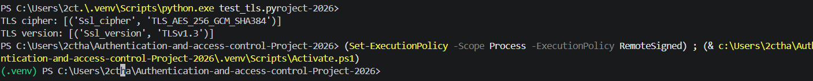
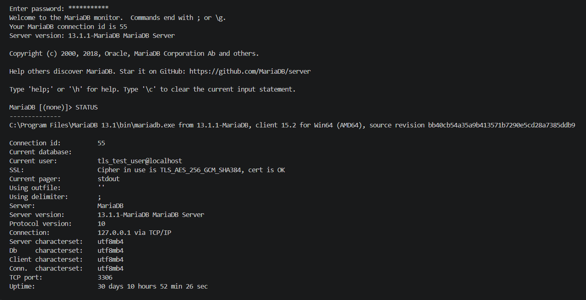
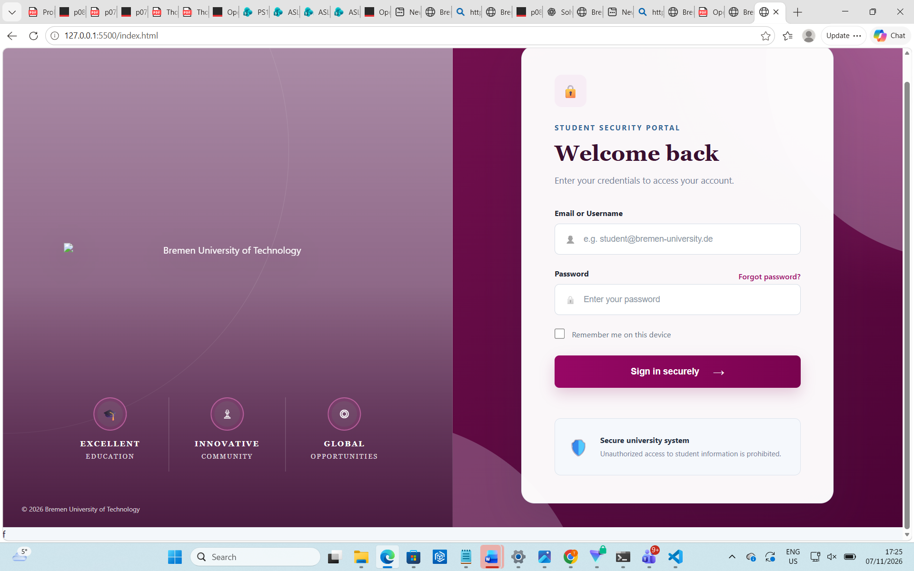
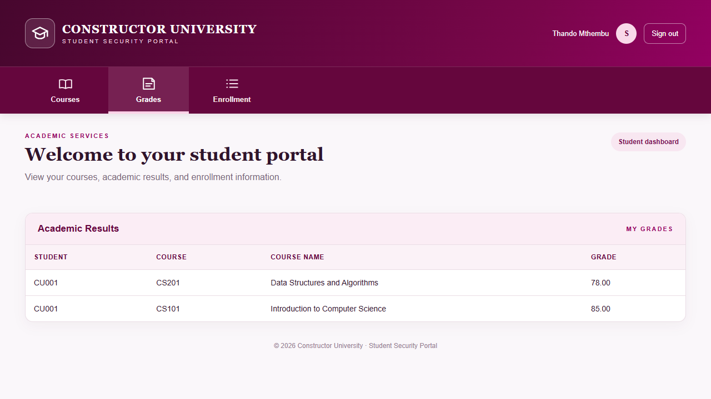

# [Area 5 - Authentication and Access Control](https://mariadb.org/bachelor_hackathon_2026-09/) | Student Security Portal
### MariaDB Authentication and Access Control Project — 2026

**Constructor University, Bremen | Databases | Topic 5: Authentication and Access Control**

## 1. Project Overview

We built a small university portal to demonstrate authentication and access control in MariaDB 13.1. The database stores students, lecturers, courses, enrolments, grades and application accounts. Students can view their own academic information, lecturers can view their assigned courses and enrolled students, and administrators can manage academic records, including grades.

Our aim was to see how roles, GRANT, DENY, elliptic-curve authentication and TLS work in practice, and to test which unauthorized operations they prevent. We also use password hashing and session-based authorization in the web application.

The system has three parts: the frontend sends HTTP requests to Flask, Flask checks the user's session and permissions and communicates with MariaDB, and MariaDB returns the results. Flask sends JSON back to the frontend. The browser never connects directly to MariaDB.

## 2. Requirements

These instructions are for Windows with a fresh installation of MariaDB 13.1 on port `3306`.

- MariaDB Server 13.1 (database development and TLS testing used 13.1.1).
- 64-bit Python 3.14 (the reproduction environment has 3.14.7).
- Git, a web browser and a text editor such as VS Code.
- HeidiSQL or another MariaDB client (the command-line client is sufficient).

The Python dependencies are Flask, MariaDB Connector/Python, python-dotenv and Werkzeug.

## 3. Getting Started

Open PowerShell and clone the repository:

```powershell
git clone https://github.com/Thandolwethu777/Authentication-and-access-control-Project-2026.git
cd Authentication-and-access-control-Project-2026
```

Use the submitted review revision when checking out the project. A clone of the upstream default branch will contain the earlier implementation until the reviewed changes are integrated.

Create a virtual environment and install the required Python dependencies by running the following commands in PowerShell:


```powershell
py -3.14 -m venv .venv
.\.venv\Scripts\python.exe -m pip install --upgrade pip
.\.venv\Scripts\python.exe -m pip install -r requirements.txt
```
## 4. MariaDB

We used HeidiSQL to create and test our database. The schema and sample records are stored separately so the database can be recreated easily.

### 4.1 Database schema

The table below shows what each table stores. It is a logical overview, rather than a complete list of SQL types and constraints.

| Table | Primary key | Other main fields | Relationships / purpose |
|---|---|---|---|
| `students` | `student_id` | `student_number`, `first_name`, `last_name`, `email` | Student details |
| `lecturers` | `lecturer_id` | `first_name`, `last_name`, `email`, `department` | Lecturer details |
| `courses` | `course_id` | `course_code`, `course_name` | Course details; assigned lecturer in the integrated application |
| `course_lecturers` | course and lecturer IDs | Both are foreign keys | Teaching assignments |
| `enrolments` | `enrolment_id` | `student_id`, `course_id`, `enrolment_date` | Links students to courses |
| `grades` | `grade_id` | `enrolment_id`, `grade` | Links grades to enrolments |
| `app_users` | `app_user_id` | `username`, `email`, `user_role`, `student_id`, `lecturer_id`, `password_hash`, `is_active`, `created_at` | Portal login and account identity |


### 4.2 Create the database and insert sample data

Use the MariaDB 13.1.1 Windows distribution with its client authentication plugins. In HeidiSQL open an administrator session using TCP, host `127.0.0.1`, and the intended port. Run `SELECT @@port, VERSION(), CURRENT_USER();` and check the result **before any setup SQL**. The fresh-install default is 3306. For the isolated reproduction use **3307** everywhere, including the client and Flask settings. Never apply these scripts to the original installation.

Open and execute the following SQL files from the repository in this order:

1. `schema.sql` — creates the database and its tables.
2. `sample_data.sql` — populates the tables with sample records.

Run the following SQL commands to verify that the database has been created and populated successfully:

```sql
USE constructor_security;
SHOW TABLES;
SELECT * FROM students;
SELECT * FROM courses;
```

The sample data includes student numbers CU001–CU003 and course codes CS101, CS201 and EC101. Use these identifiers when looking up student and course IDs.

### 4.3 Roles, GRANT and DENY

Run the role and user creation scripts as an administrator. The main database roles are `student_role`, `lecturer_role` and `admin_role`. The fresh setup provisions a dedicated PARSEC account, `backend_user`, with `backend_role` as its default role.

After schema and sample data, execute `roles.sql` and then `deny.sql` in the verified administrator session.

Verify the permissions assigned to each role by running:

```sql
SHOW GRANTS FOR student_role;
SHOW GRANTS FOR lecturer_role;
SHOW GRANTS FOR admin_role;
SHOW GRANTS FOR backend_role;
SHOW GRANTS FOR portal_demo_role;
```

Roles group permissions so that they do not have to be assigned to each user individually. DENY allows an explicit exception to a broader grant. The separate demonstration in Section 7.1 shows how this works.

## 5. Backend

The backend was built with Python, Flask, MariaDB Connector/Python, python-dotenv and Werkzeug. `db.py` handles the connection settings. The revised setup specifies PARSEC for the shared service account and requires SSL on that account. The application reads its database password from a private startup prompt or a process environment variable. Its role allows reading portal and academic data and updating the grade column. The account provisioning step checks the configured plugin and TLS requirement. Section 8 records the fresh-server and browser results.

The login endpoint retrieves the user from `app_users` and verifies the password hash. After successful login, Flask stores the user ID in a signed session cookie. Each protected request reloads the active account, role and academic identity. Protected routes check authentication and role before processing requests; unauthorized requests receive status codes such as 401 or 403. Logout clears the session.

| Access | Method and endpoint | Purpose |
|---|---|---|
| Authentication | POST `/login`, POST `/logout` | Sign in and sign out |
| Authenticated user | GET `/account-info` | Account information |
| Student | GET `/my-courses`, `/my-grades`, `/my-enrolments`, `/my-lecturers` | Own academic information |
| Lecturer | GET `/lecturer/students`, `/lecturer/courses`, `/lecturer/grades` | Assigned courses and enrolled students |
| Administrator | GET `/students`, `/lecturers`, `/admin/courses`, `/admin/enrolments`, `/admin/grades` | Administrative records |
| Administrator | PATCH `/admin/grades/<grade_id>` | Update a grade after validation |

These application roles are distinct from MariaDB database roles: all website requests use the backend database account, while Flask applies user-specific access restrictions.

### 5.1 Database authentication

On the intended server check the port and enabled plugins.

```sql
SELECT @@port, VERSION();
SELECT PLUGIN_NAME, PLUGIN_STATUS FROM information_schema.PLUGINS
WHERE PLUGIN_NAME IN ('parsec','simple_password_check','password_reuse_check');
```

PARSEC was built in and ACTIVE on the fresh Windows 13.1.1 server. On another supported build where it is absent, install the server's auth_parsec library if available and recheck the status. The Windows client library is `parsec.dll` in the MariaDB client plugin directory. Section 5.3 supplies that directory to Connector/Python. The administrator provisioning script creates backend_user with PARSEC, REQUIRE SSL and backend_role. [MariaDB PARSEC documentation](https://mariadb.com/docs/server/reference/plugins/authentication-plugins/authentication-plugin-parsec)

The team's earlier Python login on 3307 failed with 1045 despite a successful PARSEC CLI login. Fresh provisioning on 3308 succeeded with the installed Connector/Python 1.1.14, Connector/C 3.4.7 and the 3.4.10 client plugin. The CLI also required the explicit plugin directory on this machine. This establishes a working combination without identifying the cause of the historical account failure. ED25519 also authenticated successfully during comparison. Flask's final tested account used PARSEC.

#### Password complexity and reuse prevention

Return to the administrator SQL session. Install each
plugin only if it is not already active:

```sql
INSTALL SONAME 'simple_password_check';

SET GLOBAL simple_password_check_minimal_length = 8;
SET GLOBAL simple_password_check_digits = 1;
SET GLOBAL simple_password_check_letters_same_case = 1;
SET GLOBAL simple_password_check_other_characters = 1;

SHOW VARIABLES LIKE 'simple_password_check%';

INSTALL SONAME 'password_reuse_check';

SET GLOBAL password_reuse_check_interval = 0;

SHOW VARIABLES LIKE 'password_reuse_check_interval';
SHOW PLUGINS;
```

Check both plugins are active. The password policy requires eight characters, uppercase and lowercase letters, a digit and a non-alphanumeric character. An interval of zero retains password history indefinitely. Runtime settings may not persist after restart; if persistent configuration is needed, back up the server configuration, add the corresponding options, restart and verify them. Test using disposable accounts, not the application's working credentials (Section 7.2).

### 5.2 Set up the accounts

First save the non-secret connection settings in Section 5.3. After the schema, sample data, roles, DENY and password plugins are in place, run from the repository root in PowerShell.

```powershell
.\.venv\Scripts\python.exe provision_accounts.py
.\.venv\Scripts\python.exe scripts/seed_demo_users.py
```

The provisioning script prompts privately for the administrator login and new SQL account passwords. It creates the following local accounts with REQUIRE SSL, grants the named role and activates it by default. Existing incompatible accounts cause the script to stop for review. Use a clean installation for the assessed run. Applying GRANT to an existing account or role may preserve historical privileges.

| SQL user | Default role | Purpose |
|---|---|---|
| backend_user | backend_role | Flask backend, PARSEC |
| deny_test | portal_demo_role | Schema-wide SELECT with an explicit exception |
| admin_role_test | admin_role | Direct SQL academic administrator permission tests |
| student_deny_test | student_role | Direct SQL student permission tests |
| lecturer_deny_test | lecturer_role | Direct SQL lecturer permission tests |

The second command uses a provisioning identity with permission to update portal hashes. It prompts for separate application passwords (at least 12 characters) for student1, student2, lecturer1 and admin1. The sample SQL sets their foreign keys. The seeder writes Werkzeug hashes in one transaction. The web service account cannot set these passwords.

### 5.3 Configure Flask and TLS

Place non-secret settings in a project-root `.env` using the actual MariaDB installation directory.

```dotenv
DB_HOST=127.0.0.1
DB_PORT=3306
DB_USER=backend_user
DB_NAME=constructor_security
DB_PLUGIN_DIR=C:/Program Files/MariaDB 13.1/lib/plugin
MARIADB_BIN_DIR=C:/Program Files/MariaDB 13.1/bin
```

For reproduction set `$env:DB_PORT='3307'` and `$env:FLASK_PORT='5001'` in the same PowerShell window. The connector verifies the server port and negotiated encryption before returning a connection. It requests certificate verification. For a server using a private CA set `DB_SSL_CA` to its trusted PEM file and use the certificate hostname in `DB_HOST`. MariaDB 11.4+ also supports automatic TLS server verification with compatible nonempty account passwords. [MariaDB connection protocol](https://mariadb.com/docs/server/reference/clientserver-protocol/1-connecting/connection)

Remove any legacy database password from your private configuration once you have migrated. The revised application never takes its database password from a dotenv file. Launching the application prompts once and keeps the secret in the process environment. A service manager may inject `PORTAL_DB_PASSWORD` and `FLASK_SECRET_KEY` directly. The single-process classroom server otherwise generates a signing key at startup and invalidates previous cookies on restart.

```powershell
.\.venv\Scripts\python.exe test_tls.py
.\.venv\Scripts\python.exe check_transport.py
```

The following screenshots are historical team evidence. Section 8 distinguishes them from the current run.






## 6. Frontend

The frontend was developed with HTML5, CSS3 and JavaScript. It includes a university-themed login page, feedback for unsuccessful logins and dashboard navigation. Students can view grades, courses and enrolments. JavaScript sends requests to Flask and displays the returned information. The frontend does not handle database connections or serve as the final security boundary.

**Historical login page**



⭐ Student dashboard

⭐ Grades, courses and enrolments

### 6.1 Run the application

Make sure MariaDB is running. From the project folder, run:

```powershell
.\.venv\Scripts\python.exe app.py
```

Open http://127.0.0.1:5000 (http://127.0.0.1:5001 for reproduction) in a browser. Sign in with
`student1`, `student2`, `lecturer1` or `admin1` and the
password configured for that account in Section 5.2.

Flask serves the frontend, so no separate web server
is needed.

## 7. Security Testing

Below are our findings and the tests used to check the security controls. Expected outcomes are listed separately from observed results.

### 7.1 Database roles and DENY

Run the examiner's test from PowerShell after provisioning the accounts.

```powershell
.\.venv\Scripts\python.exe test_deny.py
```

The runner authenticates anew for each restricted account using its own password. It checks CURRENT_USER and the default CURRENT_ROLE before executing a probe. Provisioning also audits the role's schema SELECT grant and table-level DENY. To repeat both checks in one run use `test_deny.py --audit-policy`. The auditor reads role metadata in a separate connection. MariaDB only displays DENY lines to sufficiently privileged auditors. Course metadata must be readable, and access to app_users must fail with 1142. The student must also receive 1142 for grade UPDATE and DELETE. The lecturer must succeed on a no-row grade UPDATE and receive 1142 for DELETE. The direct academic administrator may read courses and update grade values, and must receive 1142 for account reads and grade deletion. The runner reports the expected and actual code, treats an unexpected success as failure and exits nonzero on any failed case. All reads return zero rows and all writes match zero rows. Opening the old SQL filename in HeidiSQL now stops with an explanatory message.

Historical team screenshots of the dedicated demonstration role follow.


For the student and lecturer DENY policy, repeat direct database tests as student and lecturer accounts, checking that students cannot read `app_users` or update/delete grades and lecturers cannot delete grades. Use safe no-row update/delete probes or disposable data. Record actual outcomes separately from the `portal_demo_role` demonstration.

### 7.2 PARSEC, database permissions and password policies

These are the expected results for the backend security tests.

| Control | How to retest | Expected outcome |
|---|---|---|
| PARSEC | Connect as the PARSEC backend_user with correct credentials, then with incorrect credentials | Valid login succeeds; invalid login is rejected |
| Default role | Check `CURRENT_ROLE()` as backend_user | backend_role |
| Grade deletion restriction | Issue a no-row DELETE as backend_user on the test database | Permission error |
| Password validation | Attempt to set a weak password on a disposable database account | Rejected |
| Password reuse prevention | Attempt to reuse a previously used password on a disposable account | Rejected according to policy |
| UNIQUE constraint | Attempt a second grade insert for an enrolment that already has a grade | Duplicate-key error |

The database password policy requires at least eight characters, an uppercase letter, a lowercase letter, a digit and a special character. These database policies do not automatically apply to website passwords stored in `app_users`.

On a reproduction server, run `.\.venv\Scripts\python.exe check_password_policy.py`. It tests each complexity rule, rotates a generated strong password and attempts to reuse the original. The script verifies that error 1396 from ALTER USER is accompanied by the reuse-specific 1819 diagnostic. It leaves one locked, randomly named SQL account with no application privileges. To reproduce the policy after restart reapply the five SET GLOBAL statements in Section 5.1 and check their values, or put their values in the server's [mariadb] option group and verify after restarting that instance.

### 7.3 TLS encryption, enforcement and verification

First connect using the MariaDB command-line client. Use the selected server's port (3307 for the isolated reproduction).

```powershell
$dbPort = if ($env:DB_PORT) { [int]$env:DB_PORT } else { 3306 }
$client = 'C:\Program Files\MariaDB 13.1\bin\mariadb.exe'
& $client --host=127.0.0.1 --port=$dbPort --user=root --ssl -p
```

Run these SQL statements:

```sql
SHOW GLOBAL VARIABLES WHERE Variable_name IN ('have_ssl', 'tls_version', 'require_secure_transport');
SHOW SESSION STATUS WHERE Variable_name IN ('Ssl_version', 'Ssl_cipher');
```

Our server reported TLS support and our session returned:

```text
Ssl_version = TLSv1.3
Ssl_cipher  = TLS_AES_256_GCM_SHA384
```

The exact cipher may vary with the server and client. We also found that `require_secure_transport` was OFF and an account without a TLS requirement could connect without encryption. TLS support alone was therefore not enough to guarantee encrypted connections.

On the provisioned backend_user account, run `test_tls.py` and `check_transport.py` as in Section 5.3. The same credentials must succeed with verified TLS, fail with --skip-ssl (1045) and fail with an incorrect certificate fingerprint (2026). For the Python negative test use an unrelated CA certificate. For example, in a new PowerShell window with OpenSSL on PATH, first set DB_PORT to your test port, then run:

```powershell
$unrelatedCA = Join-Path $env:TEMP ("area5-ca-" + [guid]::NewGuid() + ".pem")
openssl req -x509 -newkey rsa:2048 -nodes -keyout NUL -out $unrelatedCA -days 1 -subj "/CN=Unrelated-Rehearsal-CA"
$env:DB_SSL_CA = $unrelatedCA
.\.venv\Scripts\python.exe test_tls.py
```

The connection must fail certificate verification (2026). Close that test shell to restore the previous trust configuration. The default positive run must still succeed.

For an installer-level integrity check run `.\.venv\Scripts\python.exe check_integrity.py` on the seeded reproduction database. The script checks the connected port and rolls back the transaction. It requires duplicate-key error 1062 for repeat registrations and grades, 1452 for a missing enrolment and 4025 for a grade above 100. A pre-existing grades table from the old schema may lack the CHECK constraint because CREATE TABLE IF NOT EXISTS retains existing definitions. Inspect SHOW CREATE TABLE grades before upgrading an existing installation.

### 7.4 Website authentication, authorization and frontend tests

Use the following tests to check the complete portal:

| Test | Expected outcome |
|---|---|
| Valid credentials for each demo role | Login succeeds and appropriate information is displayed |
| Incorrect password | Login rejected and error feedback displayed |
| Missing login fields | Request rejected |
| Inactive account | Login rejected |
| Invalid grade update | Rejected |
| Student attempts admin grade update | Forbidden |
| Student dashboard navigation | Own grades, courses and enrolments displayed |
| Lecturer access | Only assigned courses and their enrolled students displayed |
| Student or lecturer requests GET `/students` or `/admin/grades` directly while logged in | 403 or other appropriate denial; no restricted data returned |
| Administrator grade update with valid input on disposable data | Authorized update succeeds |
| Logged-out request to protected endpoint | 401 or other appropriate denial |
| Logout | Session cleared; protected requests denied |

For direct GET tests, open the endpoint on the same host and port in the browser while logged in as the relevant user. Check the actual HTTP status in browser developer tools. Test access to another student's records as well as administrator-only routes; hiding buttons is not sufficient evidence of authorization.

### 7.5 Repeatable Flask checks

```powershell
.\.venv\Scripts\python.exe test_portal.py
.\.venv\Scripts\python.exe check_portal.py
```

The first command uses an in-memory SQLite fixture seeded from sample_data.sql. The second calls the real Flask request handlers and MariaDB with all four demo passwords. It includes an idempotent grade write. Run it on an idle reproduction server. To repeat the browser checks, install Playwright into the venv, have Microsoft Edge installed, start the portal as described in Section 6, and run the following in a second terminal.

```powershell
.\.venv\Scripts\python.exe -m pip install playwright
.\.venv\Scripts\python.exe check_browser.py --url http://127.0.0.1:5001
```

Use port 5000 in the URL if running with Flask's default port. The browser test opens a new context for each student, lecturer and administrator and checks the visible records after navigation. For browser-only regression testing without MariaDB, use `check_browser.py --fixture`.

## 8. Findings

### Fresh-server evidence, 26 November 2026

The test started with a new Windows MariaDB 13.1.1 data directory bound only to 127.0.0.1 on port 3308. The application used the project's schema, seed, roles, DENY, account provisioner and hash seeder. The live browser used 127.0.0.2:5001 because an existing process occupied 127.0.0.1:5001. A separate clean Python 3.14.7 venv installed requirements.txt, passed pip check and passed all five offline test groups.

| Control and identity | Operation and expected result | Observed |
|---|---|---|
| Default roles and DENY | Each restricted account connects separately; course reads succeed, prohibited statements return 1142 | All 14 SQL assertions passed across four separate identities. The direct academic administrator could update grades but could neither read app_users nor delete grades. The demo role could read courses but received 1142 on app_users despite its schema SELECT. Student grade UPDATE/DELETE and lecturer DELETE returned 1142. Lecturer no-row UPDATE succeeded |
| Service privileges | Backend reads academic data; account writes and grade INSERT/DELETE fail | Expected role active. All three prohibited writes returned 1142 |
| Database authentication | Correct PARSEC secret succeeds, incorrect secret returns 1045 | Python and CLI authenticated. Incorrect secret returned 1045 |
| TLS | Verified encrypted Python session; same-account plaintext, wrong fingerprint and unrelated CA fail | TLSv1.3, TLS_AES_256_GCM_SHA384. CLI plaintext returned 1045, wrong fingerprint 2026. Python rejected the unrelated CA with 2026 |
| Database password policy | Weak or incomplete passwords and reuse must fail | All five complexity cases returned 1819. Reuse returned 1396 with a reuse-specific 1819 diagnostic |
| Portal login and sessions | Correct credentials succeed; wrong password and inactive account fail; copied cookie after logout fails | Four users logged in; wrong password, inactive login and replay returned 401. Malformed login returned 400 |
| Flask row and role checks | Students see their records, lecturer sees CS101 only, unauthorized writes fail | HTTP 200 on assigned data, 400 on unsupported identity or course filters, 403 on student and lecturer admin writes |
| Admin and integrity | Valid grade change persists; invalid grades and inconsistent relationships fail | Changed grade read back correctly and original restored. Invalid HTTP grade 400, duplicate records 1062, missing enrolment 1452, database grade limit 4025 |
| Browser | Each login reaches its own dashboard and loads live tables | Both students, lecturer and admin passed Edge navigation and logout. Admin Save succeeded. Student1 saw CS101 85.00 and CS201 78.00 |
| Earlier 3307 baseline | Distinguish the pre-existing account and schema from the fresh server | Native service account negotiated TLS 1.3; backend grade DELETE and account UPDATE returned 1142. The original schema lacked lecturer assignments |



We found that roles made permissions easier to manage. Our DENY test showed that a user with broad read access could still be prevented from reading account information.

Another important finding was that TLS support does not mean every connection is encrypted. We were initially able to connect without TLS, but the connection was rejected when we used an account with REQUIRE SSL. Our Python connection reported TLS 1.3 and a nonempty cipher.

Authentication and authorization are different. A successful login identifies a user, but permissions and backend checks determine what that user can do. The historical CLI PARSEC exercise concerned database authentication. Werkzeug hashes protect portal passwords. The fresh PARSEC-backed Flask deployment passed the browser and API tests above.

## 9. Limitations

TLS enforcement was demonstrated on the final backend_user and historical test accounts; it is an account-level requirement. The revised CLI check rejected a deliberately incorrect certificate fingerprint. Python also rejected a valid but unrelated CA. A hostname mismatch was not separately tested.

Flask uses a shared database account, so individual portal users depend on the backend's role checks and row filtering. The database password policies do not automatically apply to portal passwords. Direct SQL student and lecturer roles can read academic rows outside a portal user's scope. Flask enforces individual row boundaries. A compromised backend credential can read all academic rows and portal hashes. The single-process server tracks active session tokens in memory for eight hours. Logout revokes the token, including copies of the cookie. Restarting ends all sessions. Multiple workers would require a shared session store.

The original repository referenced a campus photo and university-logo PNG that were absent from its history. The login page uses the existing purple gradient and the university name, and the historical screenshot is retained for comparison.

The application is an educational project running on a local Flask development server, not a production deployment.

## 10. Conclusion

Through this project we learned how database permissions, authentication and encrypted connections work together. We divided the work into MariaDB, backend and frontend development and combined the components into one university portal. Testing both allowed and forbidden operations helped us understand what each security control actually protects.


## 11. Assessment and review

### Professor feedback

| Original feedback | Correction | Files | Verification and actual outcome | Status |
|---|---|---|---|---|
| Running deny_tests.sql as root returned portal records | The old entry point stops safely. A Python runner authenticates separately for each named account, verifies the active role and asserts exact results. A separate auditor verifies the explicit exception | deny_tests.sql, test_deny.py, roles.sql, deny.sql, provision_accounts.py | Fresh 13.1.1 instance. Auditor saw the schema GRANT and table DENY. All 14 operations matched, including 1142 for the demo account reading app_users | Resolved |
| First README line lacked the project area and official link | Heading names Area 5 and links to the matching MariaDB Foundation assignment | README.md | Compared the published assignment text with the supplied screenshot and checked the first line | Resolved |
| Preserve the findings and limitations | Kept those sections, distinguished historical screenshots from fresh evidence and documented the shared-account boundary | README.md, screenshots/ | Nine local PNG references, including the new browser capture | Resolved |

### Assignment compliance

| Criterion | Initial audit | Final evidence | Assessment |
|---|---|---|---|
| Access-control depth | Partial. Roles and DENY existed, but the role test could run as root and the Flask roster was unscoped | Four direct SQL roles tested, backend privileges restricted, scope derived from active portal identity | Demonstrated |
| Authentication depth | Partial. Prior CLI PARSEC success and a native-password Flask configuration | Fresh PARSEC backend authenticated through Connector/Python, secret supplied at runtime, four portal logins | Demonstrated |
| Security-test execution | Partial. Comments described expected failures and several API routes were missing | Error-coded SQL, password-policy, integrity, Flask and browser checks executed | Demonstrated |
| TLS execution | Partial. Historical cipher and rejection evidence | TLS 1.3 with positive control, plaintext rejection, wrong fingerprint and unrelated CA rejection | Demonstrated |
| Fresh-server reproducibility | Missing linked assignments, dependencies, assets and usable setup sequence | Fresh virtual environment and empty Windows MariaDB data directory, seeded accounts and functioning dashboards | Demonstrated on Windows 13.1.1 |
| Documentation | Partial. Good historical findings, incomplete setup and screenshot paths | First-line assignment link, installation order, identity-specific tests, actual results and remaining boundaries | Demonstrated |

### Change summary

| Files | Review focus |
|---|---|
| schema.sql, sample_data.sql | Course assignments, unique registrations and final grades, grade bounds and reproducible sample joins |
| roles.sql, deny.sql, deny_tests.sql, test_deny.py, provision_accounts.py | Least privilege, role membership, policy audit and fail-closed SQL test entry point |
| db.py, app.py, scripts/seed_demo_users.py | Runtime secret handling, verified TLS, port check, distinct provisioning identity, scoped queries, sessions and grade edits |
| index.html, style.css, script.js, dashboard.html, role-dashboard.js | Login assets, role redirects, shared dashboard rendering, error states and admin grade editor |
| requirements.txt, .gitignore, test_tls.py, check_transport.py, check_integrity.py, check_password_policy.py | Pinned dependencies, private-file exclusions and reproducible database checks |
| check_portal.py, test_portal.py, check_browser.py | Live Flask, offline regression and Edge coverage |
| README.md, screenshots/ | Setup, findings, assessment tables, seven restored historical images and one new student grades capture |

For a presentation, use the schema-wide SELECT plus the app_users exception to explain DENY. Use the two different student grade lists to explain Flask's responsibility for row filtering. Use the successful TLS connection followed by the same account's plaintext and certificate failures to distinguish encryption, enforcement and server verification.
